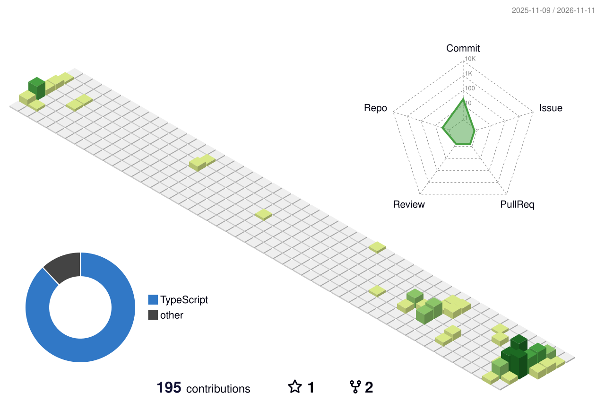

  

    <a href="https://github.com/anuraghazra/github-readme-stats">
      <!--  -->
    </a>
   
  

    
  

---
## 🛠 Tech Stacks
### ▪ Frontend

### ▪ Backend

### ▪ Tools

    

## 💼 Career
### 🪙 Traverse (2025.08~)
#### Frontend Engineer

1.국내 특화 가상자산 지갑 검증 서비스 TranSight 개발
  - 가상자산 거래 추적/분석 트랜잭션 맵 개발 및 고도화
  - 불법 지갑주소 탐색 및 동결 처리 서비스 개발 
  - 기관별 로그인 프로세스 개발

2.기업 홈페이지 및 서비스 홍보 페이지 개발
  - Traverse Homepage[🔗](https://traverse.kr/)
  - TranSight Landing Page[🔗](https://www.transight.io/)
  
### 🎭 코스타 (2025.02~2025.07)
#### 공연 관리 솔루션 '공기' Frontend Engineer

1.공연 리포트 대시보드 기획 및 구현
  - Excel로 제공되던 공연 데이터를 웹 페이지로 구현
  - UI/UX 설계 및 데이터 시각화를 통해 운영 효율 극대화

2.공연장 좌석 배치도 생성 시스템 설계 및 개발
  - SVG 기반 좌석 편집 기능 구현
  - 줌/드래그/좌석 그룹핑 등 인터랙션 구현

3.스마트 티켓 QR인증 시스템 개발
  - QR코드를 활용한 사용자 인증 및 입장 확인 시스템 구현 
    

## 📙 Education
### ▪ Codestates Frontend Bootcamp (2023.02~2023.08)
### ▪ 동국대학교 멀티미디어공학과 (2017.03~2024.08)
 - 전자전기공학부 복수전공
    

## 📪 Contact

